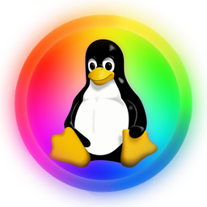
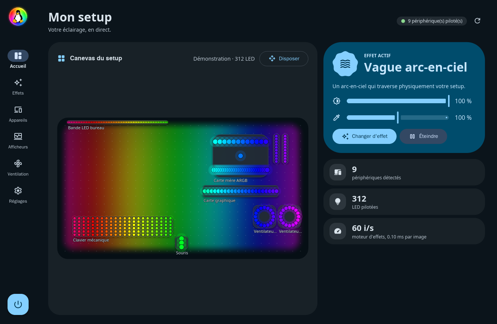
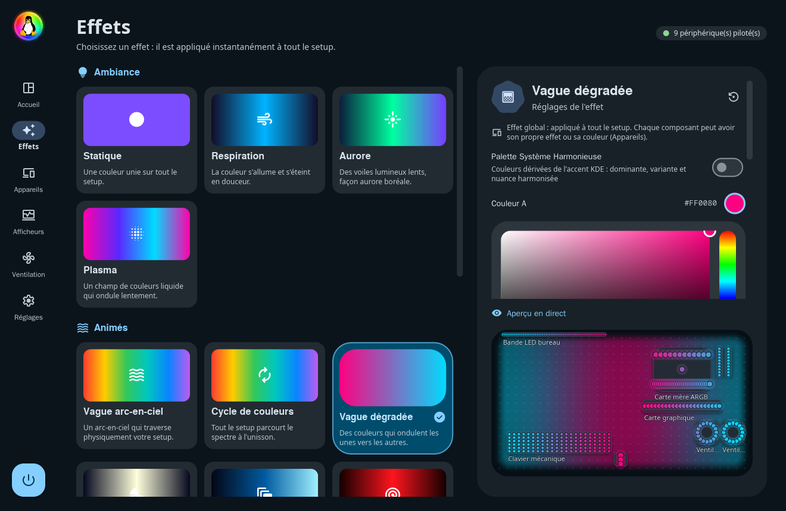
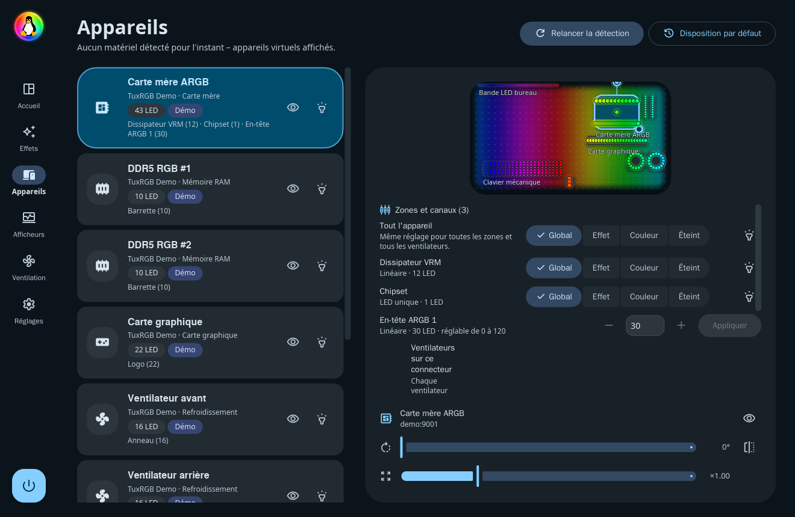
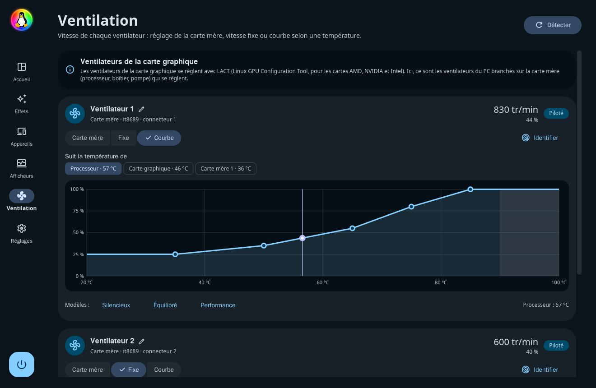
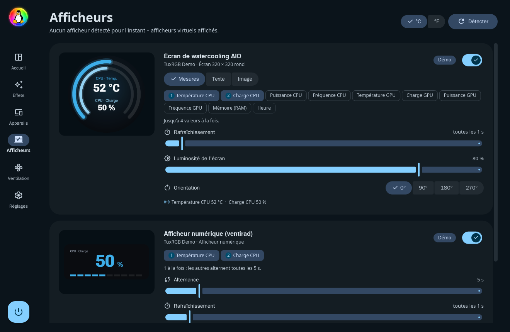
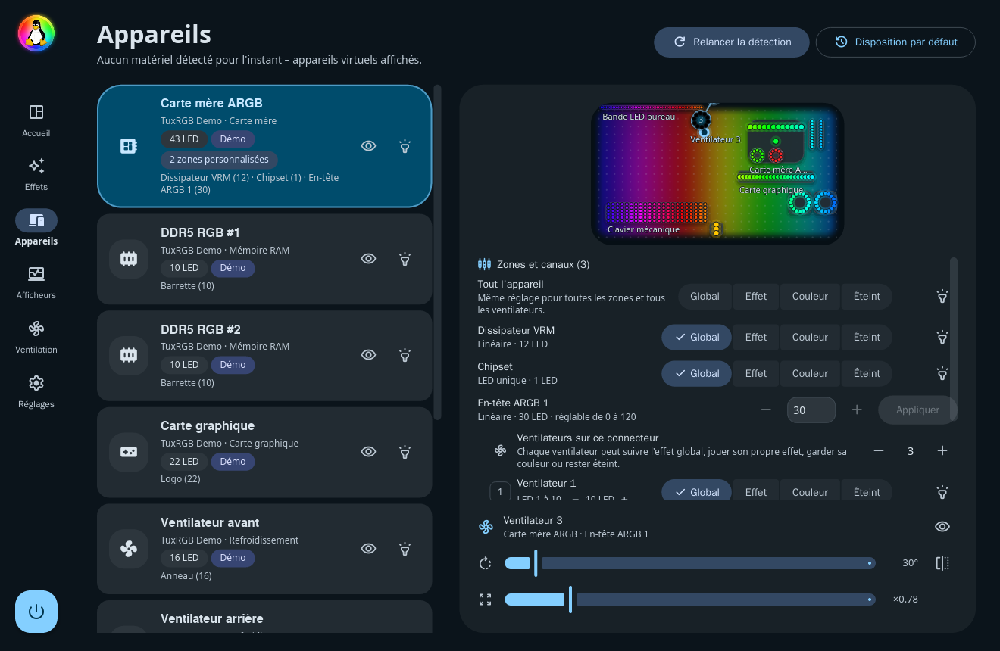
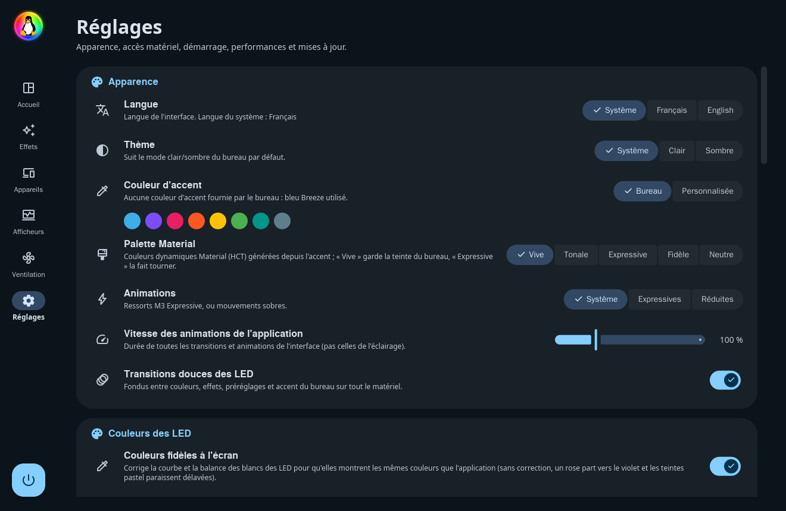

  

<h1 align="center">TuxRGB</h1>

  <b>Tout l'éclairage RGB de votre PC, dans une seule application.</b> 
  Linux (Wayland) et Windows · Material 3 Expressive · moteur OpenRGB intégré

  
  
  
  
  

  <a href="https://github.com/aurelienchartier29-netizen/TuxRGB/releases/latest"><b>Télécharger</b></a> ·
  <a href="docs/INSTALLATION.md">Installation</a> ·
  <a href="docs/FONCTIONNALITES.md">Fonctionnalités</a> ·
  <a href="docs/DEPANNAGE.md">Dépannage</a> ·
  <a href="#english">English</a>

## Ce que fait TuxRGB

- **Tout le matériel RGB** : carte mère, RAM, carte graphique, ventilateurs
  ARGB, watercooling, claviers, souris, bandes LED, lumières WLED et
  Philips WiZ. Tout ce que gère OpenRGB 1.1, qui est embarqué : rien d'autre
  à installer.
- **Un canevas à l'image de votre PC** : chaque appareil et chaque
  ventilateur est placé et tourné là où il se trouve. Une vague traverse
  vraiment le boîtier, et la synchro écran donne à chaque LED la couleur de
  la zone d'écran qu'elle couvre.
- **19 effets** (aurore, plasma, feu, comète, visualiseur audio, synchro
  écran, moniteur matériel, shaders GLSL…), un effet global ou un effet
  propre par composant, et des fondus partout.
- **Les couleurs du bureau** : accent de KDE Plasma, GNOME, COSMIC ou Windows
  suivi en direct, palette harmonieuse, et des LED réglées pour montrer les
  mêmes couleurs que l'écran.
- **Ventilation** : chaque ventilateur de la carte mère à vitesse fixe ou sur
  une courbe (processeur, carte graphique, carte mère), avec des règles de
  sécurité.
- **Afficheurs** : écrans NZXT Kraken et Corsair, afficheurs numériques
  DeepCool (températures, charge, heure, texte ou image).
- **Discret** : vit dans la zone de notification (environ 15 Mo de RAM),
  éteint les LED avec l'écran, à la mise en veille et à l'arrêt, et se met à
  jour tout seul.

Toutes les fonctionnalités, en détail : [Fonctionnalités](docs/FONCTIONNALITES.md).

## Installation

| | |
|---|---|
| **Linux** | Téléchargez `TuxRGB-…-x86_64.AppImage` dans les [Releases](https://github.com/aurelienchartier29-netizen/TuxRGB/releases/latest), rendez-le exécutable (`chmod +x`) et lancez-le. Rien à compiler, idéal aussi sur Bazzite, Aurora ou Fedora Atomic. Session Wayland et glibc ≥ 2.39. |
| **Windows 10 / 11** | Téléchargez et lancez `TuxRGB-…-Windows-Setup.exe` : l'installateur s'occupe d'OpenRGB, du pilote PawnIO et du mode administrateur. |

Au premier lancement, un assistant vérifie le système et configure l'accès au
matériel en une seule fois (mot de passe administrateur), de façon
réversible. Détails : [Installation](docs/INSTALLATION.md) ·
[Windows](docs/WINDOWS.md) · [Sécurité](docs/SECURITE.md).

## Captures

| Effets | Appareils et canevas | Ventilation |
|---|---|---|
|  |  |  |
| **Afficheurs** | **Ventilateurs par connecteur** | **Réglages** |
|  |  |  |

Toutes les captures : [Fonctionnalités](docs/FONCTIONNALITES.md#captures).

## Documentation

- [Installation et premier lancement](docs/INSTALLATION.md)
- [TuxRGB pour Windows](docs/WINDOWS.md)
- [Fonctionnalités](docs/FONCTIONNALITES.md)
- [Dépannage](docs/DEPANNAGE.md)
- [Sécurité du programme d'aide](docs/SECURITE.md)
- [Développement : architecture et compilation](docs/DEVELOPPEMENT.md)
- [Notes de version](docs/notes-de-version/)

Un problème, une idée ? Ouvrez une [issue](https://github.com/aurelienchartier29-netizen/TuxRGB/issues) ; le rapport matériel
(Réglages → Accès matériel → « Copier le rapport matériel ») aide beaucoup.

## Licences

* TuxRGB : **GPL-2.0-or-later** (`LICENSE`).
* Icônes : Material Symbols Rounded (Apache-2.0, Google), sous-ensemble dans
  `crates/tuxrgb/assets/fonts`.
* OpenRGB 1.1 (embarqué, processus séparé) : GPL-2.0-or-later, sources dans
  `third_party/openrgb` (voir `third_party/README.md`). Qt 6 : LGPL-3.0.
* `openrgb2` (client SDK, lié au binaire) est publié sous « GPL-2.0 » sans
  mention « or later » dans ses métadonnées, alors que quelques dépendances
  Rust de l'interface (winit, ab_glyph…) sont sous Apache-2.0 seule, une
  combinaison que la FSF juge incompatible avec la GPLv2 seule. À clarifier
  avec l'auteur d'openrgb2 (une autorisation « or later » suffit) avant une
  diffusion large.
* Liste complète : application → Réglages → **Crédits & licences**, et
  `CREDITS.md`.

TuxRGB n'est affilié ni à WhirlwindFX (SignalRGB) ni au projet OpenRGB. Le
manchot de l'icône est Tux, de Larry Ewing (lewing@isc.tamu.edu), créé avec The GIMP,
placé sur un fond RGB.

## English

TuxRGB drives all the RGB lighting of a PC from one application, on Linux
(native Wayland) and Windows 10 / 11: motherboard, RAM, graphics card, ARGB
fans, AIO coolers, keyboards, mice, LED strips, WLED and Philips WiZ lights.
The OpenRGB 1.1 engine is built in, so there is nothing else to install. It
also controls fan speeds (fixed or curves) and the screens of NZXT Kraken,
Corsair and DeepCool coolers and cases.

The interface speaks English and French (it follows the system language).
Download the AppImage (Linux) or the installer (Windows) from the
[Releases](https://github.com/aurelienchartier29-netizen/TuxRGB/releases/latest) page; a first-run wizard sets up hardware
access. The documentation of this repository is in French; questions and
reports in English are welcome in the [issues](https://github.com/aurelienchartier29-netizen/TuxRGB/issues).
