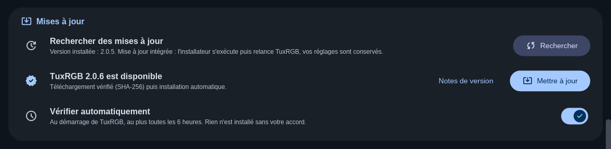
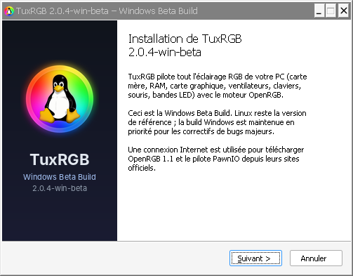
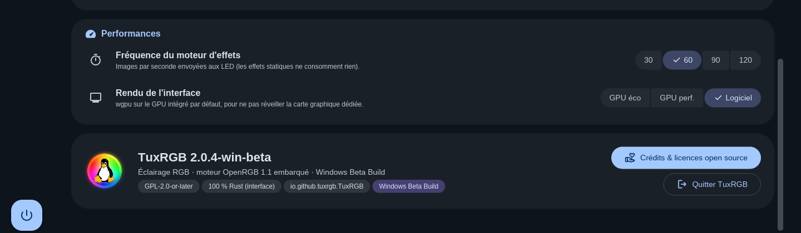
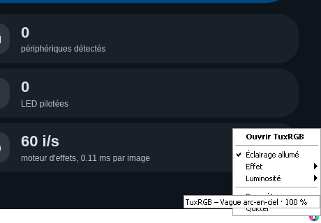
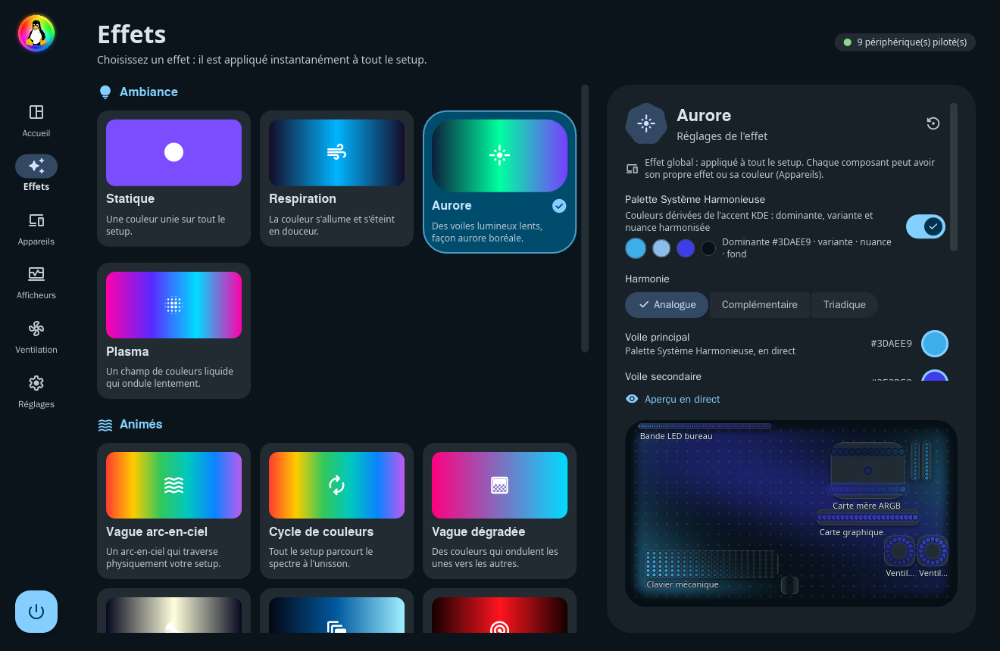
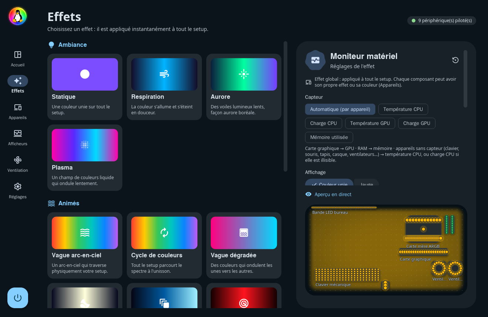
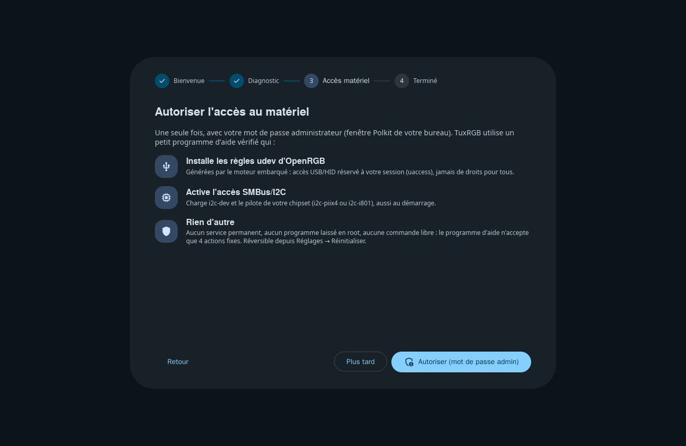
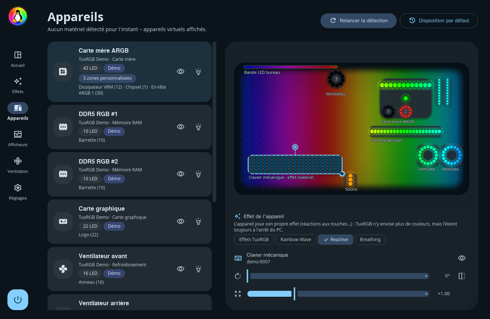
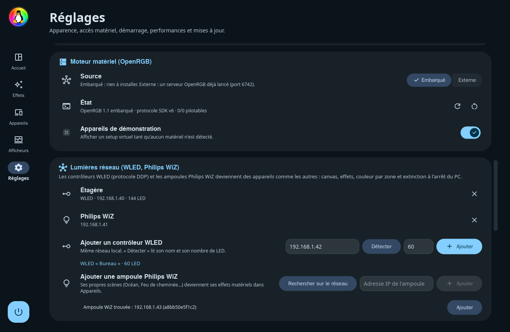
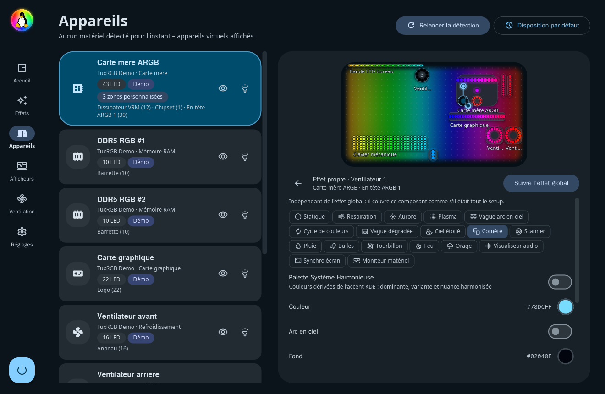

<p align="center">
  
</p>

<h1 align="center">TuxRGB</h1>

<p align="center">
  Éclairage RGB pour Linux et Windows — Wayland natif, Material 3 Expressive, couleurs du bureau (KDE, GNOME, COSMIC),<br>
  français / anglais, moteur matériel <b>OpenRGB intégré</b> (1.0 + derniers ajouts de matériel) : rien d'autre à installer.
</p>


TuxRGB pilote l'éclairage de tout le PC (carte mère, RAM, carte graphique,
ventilateurs, watercooling, claviers, souris, bandes LED…) depuis une seule
interface. Les appareils sont placés sur un **canevas** qui reproduit votre
setup : une vague arc-en-ciel traverse réellement votre bureau, de gauche à
droite, et en synchro écran chaque LED reprend exactement la zone de l'écran
qu'elle couvre. Tout le fond du canevas diffuse un rendu adouci et flouté de
l'effet, avec les appareils nets par-dessus.

> **Windows 10 / 11** : la même application, publiée en même temps que Linux
> et avec les mêmes correctifs (installateur `.exe` dans la même release) ;
> voir la section « Windows » plus bas.

| | |
|---|---|
| Interface | 100 % Rust, [iced 0.14](https://iced.rs) (wgpu, repli tiny-skia), Wayland pur (pas de X11/XWayland) |
| Mouvement | **Rien ne change brusquement** : transitions « fade through » M3 entre pages, sous-pages et étapes de l'assistant (fondu sortant puis entrant avec léger agrandissement, sans recalcul de la mise en page) ; boîtes de dialogue qui s'estompent et grandissent, voile qui s'assombrit ; sélecteur de couleur et bandeaux qui se déplient / se replient en fondu ; contenu des panneaux (effet, appareil, statuts) qui apparaît en fondu ; boutons, segments, puces et cartes qui glissent vers leurs nouvelles couleurs ; champs de saisie et barres de défilement qui s'animent ; défilement à la molette fluide ; nouveaux appareils qui apparaissent en fondu dans la liste et sur le canevas ; **vitesse réglable** de toutes ces animations (Réglages → Apparence, 25 à 300 %) |
| Design | Material 3 Expressive : formes très arrondies et formes « cookie », hiérarchie stricte des surfaces, **curseurs expressifs** (piste qui s'épaissit au survol et à la saisie, poignée qui s'affine puis s'écrase / s'étire selon la vitesse, valeur qui suit le doigt par ressort, extrémités élastiques, crans, bulle de valeur), **boutons « squish »** (compression à ressort au clic, gonflement au survol, morphing pilule → squircle), interrupteurs dont le pouce s'étire en glissant, couleurs dynamiques HCT |
| Langues | Français et anglais, langue du système détectée (`LC_ALL` > `LC_MESSAGES` > `LANG` > `LANGUAGE`), choix manuel dans Réglages → Apparence |
| Bureau | KDE Plasma, GNOME, COSMIC (accent via le portail `org.freedesktop.portal.Settings`, repli `kdeglobals` / `gsettings` / thème COSMIC), libellés adaptés (« Synchroniser avec l'accent GNOME »…), avertissement clair pour X11, un bureau sans accent ou une distribution non testée |
| Matériel | OpenRGB 1.1 (16/10/2026) embarqué, lancé en serveur SDK privé (127.0.0.1:6743) : 100 % des périphériques pris en charge par OpenRGB |
| Effets | 19 effets : Statique, Respiration (multi-teintes), Aurore, Plasma, Vague arc-en-ciel, Cycle de couleurs, Vague dégradée, Ciel étoilé, Comète, Scanner, Pluie, Bulles, Tourbillon, Feu, Orage, **Shader GLSL** (GPU), **Visualiseur audio** (PipeWire, sur chaque appareil), **Synchro écran** (portail ScreenCast, par LED), **Moniteur matériel** (température / charge CPU-GPU, mémoire ; en mode automatique, carte graphique → GPU, RAM → mémoire, appareils sans capteur → température CPU, ou charge CPU si elle est illisible) |
| Couleurs | **Palette Système Harmonieuse** (dominante = accent exact du bureau, variante, nuance analogue / complémentaire / triadique), **fondus** entre couleurs, effets, préréglages et changements d'accent (1,2 s), luminosité globale qui suit le curseur quasi instantanément, **saturation 0–200 % perceptuelle** (Okhsv / OKLab : aucune dérive de teinte, aucun écrêtage, luminosité inchangée) appliquée sur le matériel dès l'image suivante |
| Global ou par composant | L'effet de la page Effets s'applique **à tout le setup**. Chaque composant du canevas (appareil, zone, ventilateur) peut aussi **suivre l'effet global**, jouer **son propre effet** avec ses propres réglages (il couvre alors ce composant comme s'il était tout le setup), garder une **couleur** ou rester **éteint** ; « Tout synchroniser » remet tout sur l'effet global |
| Ventilateurs | **Par ventilateur, par connecteur** : un connecteur ARGB se divise en ventilateurs (comme les segments d'OpenRGB, nombre de LED propre à chacun), chacun est un élément du canevas qui se place, se tourne et se redimensionne seul |
| Canevas | **Rotation libre** de chaque élément (curseur 0–359°, poignée de rotation sur le canevas, angles droits magnétiques), éléments **masquables** (toujours connectés et éclairés), élément sélectionné au premier plan, miroir, taille |
| Afficheurs | Page **Afficheurs** : écrans des watercoolings **NZXT Kraken** Z / 2023 / 2024 et **Corsair** (iCUE ELITE LCD, iCUE LINK LCD, XC7, Nautilus), afficheurs numériques **DeepCool** (AK, AG, LS, LD, LP, LQ, AK Digital Pro, boîtiers CH) : température / charge / puissance / fréquence CPU et GPU, mémoire, heure, texte ou image, activation, fréquence de rafraîchissement, luminosité et orientation des écrans, aperçu en direct ; pilotes libres en USB HID, sans logiciel du fabricant |
| Effets matériels | Un clavier, une souris ou une ampoule WiZ peut jouer **son propre effet** (réactions aux touches, scènes) au lieu de ceux de TuxRGB |
| Lumières réseau | Contrôleurs **WLED** (DDP, nombre de LED détecté) et ampoules **Philips WiZ** (recherche sur le réseau) : des appareils comme les autres |
| Accès matériel | Assistant de premier lancement + « Réinitialiser les permissions / Accès matériel » (Polkit/pkexec, programme d'aide vérifié), correctif SMBus sur toutes les distributions, appliqué seulement si nécessaire |
| Zone de notification | StatusNotifierItem (ksni), catégorie *ApplicationStatus* (à côté de Steam, pas parmi les contrôles système) : effet, luminosité, extinction, sans fenêtre ouverte ; notifications de bureau avec action directe |
| Extinction | **Toutes** les LED (carte mère et ventilateurs compris) éteintes à l'arrêt, au redémarrage, à la mise en veille et à la fermeture de session, avec un délai strict de 400 ms (inhibiteur logind / `WM_QUERYENDSESSION`) : l'arrêt du système n'est jamais ralenti ; état exact restauré au démarrage |
| Mises à jour | Réglages → **Mises à jour** : version la plus récente lue sur les releases GitHub, téléchargement vérifié (taille, SHA-256, format), AppImage remplacée sur place puis redémarrage (Linux), installateur silencieux qui relance TuxRGB (Windows) ; vérification automatique au démarrage, au plus toutes les 6 heures (désactivable) ; Flatpak et paquets : page de la version |
| Distribution | AppImage prête à l'emploi (Bazzite, Aurora…), manifest Flatpak, fichiers pour paquets natifs |
| Sobriété | Aperçu ralenti à quelques images par seconde dès que la fenêtre n'est plus dessinée (réduite, autre bureau), moteur d'effets endormi quand rien n'utilise ses images, aucun tampon alloué par image (LED, captures d'écran, shaders), lueur des aperçus calculée hors du fil de l'interface, mémoire de la fenêtre rendue au système quand elle se ferme (environ 15 Mo de RAM lancé dans la zone de notification) |

## Démarrage rapide

L'AppImage se télécharge depuis la page [**Releases**](https://github.com/aurelienchartier29-netizen/TuxRGB/releases/latest) du dépôt GitHub
(dans l'archive complète du projet, elle est déjà dans `dist/`).

### Bazzite, Aurora, Bluefin, Fedora Atomic (systèmes immuables)

Rien à compiler, rien à « layer » avec rpm-ostree :

```sh
cd dist
./run-tuxrgb.sh              # lance l'AppImage pré-compilée
./run-tuxrgb.sh --install    # (facultatif) copie dans ~/Applications + entrée de menu
./run-tuxrgb.sh --check      # diagnostic rapide du système
```

Gear Lever (préinstallé sur Bazzite) peut aussi intégrer
`TuxRGB-3.1.2-x86_64.AppImage` au menu.

### Autres distributions

```sh
chmod +x dist/TuxRGB-3.1.2-x86_64.AppImage
./dist/TuxRGB-3.1.2-x86_64.AppImage
```

L'AppImage nécessite glibc ≥ 2.39 (Fedora 40+, Ubuntu 24.04+, Debian 13,
Arch, openSUSE Tumbleweed…) et une session Wayland.

Ensuite, TuxRGB se met à jour tout seul : **Réglages → Mises à jour →
Rechercher** télécharge la nouvelle AppImage depuis les releases GitHub,
vérifie sa somme SHA-256, la met à la place de l'ancienne (même dossier ; un
nom qui contient le numéro de version est renommé) et redémarre TuxRGB.

### Premier lancement

1. **Bienvenue**, puis **Diagnostic** : règles udev, `i2c-dev`, pilote SMBus
   du chipset, accès aux `/dev/i2c-*` et `/dev/hidraw*`, moteur OpenRGB.
2. **Accès matériel** : un clic, votre mot de passe administrateur dans la
   fenêtre Polkit de KDE/GNOME. Le programme d'aide `tuxrgb-helper` :
   * installe les règles udev **générées par l'OpenRGB embarqué**
     (`openrgb --print-udev-rules`, au moment de la compilation) et validées
     ligne par ligne (seuls `TAG+="uaccess"`, les étiquettes et les
     `chmod a+w /sys/…` d'OpenRGB sont acceptés : aucun
     `RUN`/`PROGRAM`/`IMPORT` arbitraire). Sans règles fournies par la
     distribution : `/etc/udev/rules.d/60-openrgb.rules`. Si la distribution
     en fournit déjà (`/usr/lib/udev/rules.d/60-openrgb.rules`, ex. Bazzite) :
     seulement les appareils qui y manquent, dans
     `/etc/udev/rules.d/61-tuxrgb-openrgb-extra.rules` – plus de doublon ni
     d'avertissement « Multiple OpenRGB udev rules » ;
   * **aucun droit universel** : l'accès aux `/dev/hidraw*` et `/dev/i2c-*`
     passe uniquement par `TAG+="uaccess"` (ACL de la session active). Les
     quelques règles d'OpenRGB qui rendaient des fichiers de claviers de
     portables ASUS/faustus modifiables par tous (`chmod a+w`) sont retirées,
     et si la distribution les fournit, TuxRGB les annule (`chmod go-w`) ;
     tout `MODE` donnant un droit aux « autres » est refusé ;
   * écrit `/etc/modules-load.d/tuxrgb-i2c.conf` (`i2c-dev` + `i2c-piix4`
     ou `i2c-i801` selon le contrôleur SMBus PCI détecté) et charge les modules ;
   * recharge udev (`udevadm control --reload-rules && udevadm trigger`) ;
   * note ce qu'il a créé dans `/var/lib/tuxrgb/installed.list` (et
     sauvegarde un éventuel fichier existant).
3. **Terminé** : OpenRGB redémarre et détecte vos périphériques. Option
   « Lancer TuxRGB à l'ouverture de session » (activée par défaut) : au
   démarrage, TuxRGB s'installe directement dans la zone de notification et
   réapplique votre éclairage.

### Sécurité du programme d'aide (`tuxrgb-helper`)

* Seul composant exécuté en root, via Polkit (`pkexec`), le temps d'une
  action. Il n'accepte que 4 verbes fixes (`install`, `enable-smbus`,
  `reset`, `status`), sans aucun autre argument ; aucune commande ne passe
  par un shell.
* Environnement effacé, `PATH` réduit aux dossiers système (pas de
  `/usr/local`), `umask 022` ; un outil (`udevadm`, `modprobe`,
  `rpm-ostree`, `grubby`…) n'est lancé que s'il appartient à root et n'est
  modifiable par personne d'autre.
* Paramètre noyau : une seule valeur possible, `acpi_enforce_resources=lax`,
  vérifiée par liste blanche et jeu de caractères strict avant tout outil ou
  fichier (testé contre `; rm -rf /`, `$(id)`, `init=/bin/sh`…). La méthode
  est choisie selon le système : `rpm-ostree kargs` (Bazzite, Fedora Atomic),
  `grubby` (Fedora, RHEL, Nobara), `kernelstub` (Pop!_OS),
  `/etc/default/grub` + `update-grub` / `grub-mkconfig` / `grub2-mkconfig`
  (Debian, Ubuntu, Mint, Arch, openSUSE), entrées systemd-boot
  (`/boot/loader/entries/*.conf` + `/etc/kernel/cmdline`), rEFInd
  (`refind_linux.conf`) ; NixOS et openSUSE transactionnel reçoivent les
  instructions exactes. **Rien n'est touché si le contrôleur SMBus a déjà
  son pilote** (accès RAM fonctionnel) ; chaque fichier modifié est
  sauvegardé dans `/var/lib/tuxrgb/boot-backup/` et noté pour
  « Réinitialiser ».
* Règles udev reçues : taille et longueur de ligne bornées, ASCII, pas de
  caractères de contrôle, clés et affectations sur liste blanche.
* Écritures atomiques sans suivre de lien symbolique (`O_EXCL`) ; copie
  temporaire du programme d'aide (AppImage) sous un nom unique, en 0500,
  vérifiée puis supprimée après usage ; l'UID demandeur est journalisé.

### Fenêtre, démarrage et sauvegarde

* Lancé depuis le menu : fenêtre **maximisée**. Lancé à l'ouverture de
  session (`--minimized`) : **zone de notification** uniquement.
* « Réduire » garde TuxRGB dans la **barre des tâches** (et dans la zone de
  notification) ; le bouton ✕ le range dans la zone de notification. Lancée
  directement, l'AppImage crée son entrée de menu et son icône dans
  `~/.local/share` pour que la barre des tâches affiche la bonne icône ; une
  nouvelle version remplace l'ancienne icône à toutes les tailles (32 à
  256 px) et rafraîchit les caches d'icônes de KDE / GTK.
* **Changer d'icône** : `python3 scripts/set-icon.py mon-icone.png` (ou .svg)
  régénère toutes les tailles (menu, fenêtre, zone de notification de 22 à
  128 px, logo HiDPI), puis reconstruire l'AppImage.
* **Instance unique** : relancer TuxRGB alors qu'il tourne déjà (menu, raccourci,
  zone de notification) ramène la fenêtre existante au premier plan
  (nom D-Bus `io.github.tuxrgb.TuxRGB`) – jamais deux moteurs OpenRGB.
* **Tous les réglages** (effet, couleurs, synchronisation avec le bureau,
  palette, luminosité, saturation, disposition avec rotation / miroir, tailles
  des connecteurs ARGB, langue, apparence, comportement) sont dans
  `~/.config/tuxrgb/config.json` : écrits une seconde après chaque
  changement, à la fermeture de la fenêtre et à la déconnexion / l'extinction,
  puis réappliqués dès le lancement (fondu d'entrée). Un ancien `config.toml`
  est converti automatiquement, et la saturation par effet des versions 1.x
  devient la saturation globale.
* **Extinction propre** : TuxRGB prend un inhibiteur « delay » de logind ;
  à `PrepareForShutdown` / `PrepareForSleep`, toutes les LED passent au noir
  immédiatement (sans fondu) – chaque contrôleur reçoit le noir en même
  temps, puis une deuxième fois dès la première confirmée –, et l'arrêt
  continue au plus tard 400 ms après (délai strict, le système n'est jamais
  ralenti). À la fermeture de session (SIGTERM), même chose ; le serveur
  OpenRGB bloque SIGTERM pour survivre le temps d'envoyer le noir. Au réveil,
  l'éclairage revient en fondu.

« Plus tard » laisse TuxRGB fonctionner en accès limité. Tout est réversible :
**Réglages → Accès matériel → Réinitialiser les permissions / Accès matériel**
retire exactement ce qui a été installé, restaure l'ancien fichier, efface
l'état du premier lancement et relance l'assistant (utile après un changement
de carte mère, de RAM ou de périphérique). Même chose en ligne de commande :
`tuxrgb --reset-hardware`.

## Windows — `TuxRGB-3.1.2-Windows-Setup.exe`

La version Windows (10 / 11, 64 bits) est publiée **en même temps que Linux,
dans la même release**, avec les mêmes correctifs.

**Installation** : télécharger `TuxRGB-3.1.2-Windows-Setup.exe` (page
Releases), double-cliquer, suivre l'installateur. Il installe TuxRGB dans
`C:\Program Files\TuxRGB`, crée les raccourcis, puis :

* fait télécharger par TuxRGB lui-même (HTTPS, sans aucun script) **OpenRGB
  1.1** pour Windows depuis sa source officielle (Codeberg / openrgb.org), le
  même moteur que celui embarqué dans l'AppImage, lancé par TuxRGB en serveur
  SDK privé ;
* installe le pilote **PawnIO** (accès SMBus : carte mère, RAM — facultatif),
  dont l'installateur officiel, signé par son auteur, est inclus ;
* et configure le **mode administrateur** (facultatif) : une tâche planifiée
  relance TuxRGB avec les droits administrateur, sans invite UAC à chaque
  démarrage, condition imposée par Windows pour lire le SMBus.

**Mises à jour** : Réglages → Mises à jour → Rechercher. TuxRGB télécharge
le nouvel installateur, vérifie sa somme SHA-256 et le lance en mode mise à
jour (`/S /UPDATE`, une confirmation Windows) : installation silencieuse qui
ne remplace que TuxRGB (OpenRGB, PawnIO, mode administrateur et raccourcis
gardés tels quels), puis TuxRGB redémarre tout seul.

| Réglages : mises à jour | Installateur |
|---|---|
|  |  |
|  |  |

Ce qui est **identique** à Linux : toute l'interface iced / Material 3
Expressive, les animations, les effets, les profils, le canevas spatial
(ventilateurs par connecteur, rotation, masquage), les effets matériels, les
lumières réseau WLED / Philips WiZ et le moteur OpenRGB. Ce qui **change**, par compilation conditionnelle
(`#[cfg(target_os = "windows")]`, dossier `crates/tuxrgb/src/win/`) :

| Linux | Windows |
|---|---|
| Visualiseur audio : moniteur PipeWire | Capture **WASAPI** en boucle de la sortie par défaut (suit le changement de casque / enceintes) |
| Synchro écran : portail ScreenCast + PipeWire | Écran principal par GDI (les jeux en plein écran exclusif restent noirs : utiliser « fenêtré sans bordure ») |
| Zone de notification : StatusNotifierItem (ksni) | Icône **Win32** (`Shell_NotifyIconW`), même menu, notifications en bulles / toasts |
| Extinction / veille : inhibiteur logind (400 ms au plus) | `WM_QUERYENDSESSION` / `WM_ENDSESSION` / `WM_POWERBROADCAST` : toutes les LED à 0 % à l'arrêt, au redémarrage, à la fermeture de session et à la mise en veille, en moins d'une demi-seconde, restaurées au réveil et au démarrage suivant |
| Accent : portail, kdeglobals, gsettings | **WinRT** `UISettings.GetColorValue(Accent)`, repli registre (`DWM\AccentColor`), mode clair / sombre et « effets d'animation » de Windows, suivis en direct (`WM_SETTINGCHANGE`) |
| Instance unique : D-Bus | Mutex nommé + `WM_COPYDATA` |
| Démarrage avec la session : `~/.config/autostart` | Clé `HKCU\…\Run` |
| Accès matériel : udev, i2c-dev, Polkit | PawnIO + mode administrateur (UAC une seule fois) |
| Capteurs : hwmon, `/proc`, RAPL | Charge et fréquence CPU, mémoire ; charge et température de toute carte graphique par Windows (compteurs du Gestionnaire des tâches, noyau graphique), détails NVIDIA via `nvidia-smi` ; température et puissance du CPU (Ryzen, Intel Core) par le pilote signé **PawnIO** en mode administrateur, ou **LibreHardwareMonitor** s'il est ouvert |

Compiler la version Windows :

```sh
# Depuis Linux (compilation croisée) : mingw-w64 + nsis
bash scripts/windows/build-windows.sh    # → dist/TuxRGB-3.1.2-Windows-Setup.exe
```

```powershell
# Sous Windows : Rust (rustup) + NSIS (installé via winget si absent)
scripts\windows\build-windows.cmd       # double-clic, ou build-windows.ps1
```

Réglages : `%APPDATA%\tuxrgb` — journaux et rapport matériel :
`%LOCALAPPDATA%\tuxrgb`. Les retours sont les bienvenus (onglet *Issues*).

## Captures

| Effets | Palette Système Harmonieuse | Moniteur matériel |
|---|---|---|
|  |  |  |

| Appareils et canevas | Réglages | Assistant |
|---|---|---|
|  |  |  |

| Ventilateurs par connecteur | Effet matériel d'un clavier | Lumières réseau (WLED, WiZ) |
|---|---|---|
|  |  |  |

| Effet propre d'un ventilateur | Afficheurs (écran AIO, afficheur numérique) |
|---|---|
|  |  |

Les mêmes captures en anglais sont dans `docs/screenshots/en/` (utilisées par
la fiche AppStream). Elles sont produites par `tuxrgb --screenshot-tour`, qui
ne modifie jamais `config.json`.

## Architecture

```
┌──────────────────────── processus tuxrgb (Rust) ────────────────────────┐
│ GUI iced 0.14 (Wayland)  ◄── abonnement « services » (tokio) ──┐        │
│  pages · canevas · thème M3  │  ├─ portail Settings / kdeglobals (accent)│
│  ressorts à 60 i/s seulement │  ├─ tray ksni (StatusNotifierItem)       │
│  pendant les animations      │  ├─ captures PipeWire (si effet réactif)  │
│                              │  ├─ afficheurs (thread, USB HID)          │
│                              │  └─ flux d'aperçu ≤ 30 i/s (fenêtre ouverte)
│ moteur d'effets (thread) ── tick fixe si animé, endormi si statique ───┐ │
│   └─ Arc<Frame> ─► watch ─► pont OpenRGB (thread + runtime dédié) ───┐ │ │
└─────────────────────────────────────────────────────────────────────┼─┼─┘
                       SDK OpenRGB v6, 127.0.0.1:6743 (privé)         │
┌──────────────── openrgb --server (OpenRGB 1.1, embarqué) ───────────▼──┐
│ détection SMBus/I2C · HID · USB · série · réseau → vos périphériques    │
└─────────────────────────────────────────────────────────────────────────┘
```

* **Aperçu immersif** : fenêtre ouverte, le moteur évalue aussi l'effet sur
  une grille de 48 × 27 points couvrant tout le canevas (son propre état,
  même luminosité, saturation et fondus que les LED). L'interface en fait
  une image floutée (agrandissement ×4, trois flous de boîte ≈ gaussien,
  bords adoucis) placée sous les appareils. Rien n'est calculé dans la zone
  de notification.
* **Réactivité des curseurs** : la saturation est appliquée telle quelle et
  la luminosité lissée dans le moteur (constante de temps 35 ms : la première
  image bouge déjà, ~95 % en 0,1 s) au lieu de relancer un fondu à chaque
  pas ; un curseur qui bouge fait rendre une image tout de suite, sans
  attendre le prochain tic (au plus deux fois la cadence) ; les commandes en
  rafale sont appliquées d'un coup avant chaque image ; côté OpenRGB, la dernière
  image gagne toujours (envoi groupé), et la couleur d'un appareil SMBus
  retenue par la limite de 10 écritures/s est envoyée dès qu'elle est due ;
  les mises à jour D-Bus de la zone de notification sont regroupées (au plus
  une toutes les 150 ms, la dernière valeur toujours envoyée).
* **Moteur d'effets** (`tuxrgb-core`) : rendu en espace « canevas » 16:9,
  cadence fixe (30–120 i/s) avec échéance absolue, **0 réveil pour un effet
  statique** (renvoi de maintien toutes les 10 s, et le moteur se rendort dès
  la fin d'un fondu). Saturation (0–200 %, Okhsv : teinte et valeur
  perceptuelles conservées, courbe douce sans écrêtage au-delà de 100 %,
  mémorisée par couleur) puis luminosité appliquées en logiciel sur chaque
  LED ; fondus en virgule flottante (sinus entrée/sortie)
  depuis ce que les LED affichent, y compris au milieu d'un autre fondu.
  Mesuré en debug : < 0,1 ms par image pour ~300 LED.
* **Plugins OpenRGB, en natif** : les fonctions des plugins *Effects*,
  *Visual Map* et *Hardware Sync* sont réimplémentées en Rust dans TuxRGB
  (leurs sources ne sont pas embarquées) : effets avancés, shaders GLSL
  (convention Shadertoy, `~/.config/tuxrgb/shaders/custom.frag`, rendus par
  wgpu en 128×72 puis échantillonnés à la position de chaque LED), carte
  visuelle (rotation, miroir, poignée de redimensionnement, zone d'écran par
  LED) et moniteur matériel (hwmon `k10temp`/`coretemp`/`amdgpu`,
  `/proc/stat`, `/proc/meminfo`, `nvidia-smi`).
* **Pont OpenRGB** (`tuxrgb-openrgb`) : trouve le binaire embarqué, le lance
  en `--server --noautoconnect` avec sa propre configuration
  (`~/.config/tuxrgb/openrgb`, n'interfère pas avec un OpenRGB installé),
  `PR_SET_PDEATHSIG` pour qu'il ne survive jamais à TuxRGB, met chaque
  contrôleur en mode *Direct*, n'envoie que les appareils dont les couleurs
  ont changé, se reconnecte et redémarre le serveur si besoin. Un serveur
  OpenRGB externe (port 6742) peut être choisi dans les réglages. Les
  appareils laissés à leur **effet matériel** reçoivent leur mode une fois,
  puis plus aucune couleur (sauf le noir à l'extinction). Les **lumières
  réseau** (WLED en DDP, Philips WiZ) sont écrites dans les réglages du
  serveur privé (`DDPDevices`, `PhilipsWizDevices` de son `OpenRGB.json`,
  le reste du fichier conservé) avant son lancement.
* **Ventilateurs par connecteur** (`tuxrgb-core::lighting`) : un connecteur
  divisé en ventilateurs (parts égales, tailles propres à chacun, ou segments
  d'OpenRGB) ; chaque ventilateur est un élément du canevas (anneau de LED
  dans son propre rectangle, rotation et miroir à lui) qui reste dans son
  appareil, à l'endroit des LED du connecteur, tant qu'il n'a pas été
  déplacé.
* **Effets par composant** (`tuxrgb-core::engine`) : les LED d'un même
  appareil qui jouent le même effet propre forment un groupe, rendu à part
  avec son propre état et sa propre horloge, sur leurs positions étirées sur
  leur propre boîte (une vague traverse le ventilateur ou le clavier
  concerné) ; l'effet global continue sans être réinitialisé quand on règle
  un composant. Les entrées (son, écran, capteurs) suivent les besoins de
  l'effet global et de tous les effets propres.
* **Rotation libre** (`tuxrgb-core::layout`) : chaque élément garde son
  rectangle d'origine et un angle quelconque ; LED, zones, ventilateurs
  ancrés, détection au pointeur et poignées sont calculés dans le repère de
  l'élément, en proportions physiques (un carré reste un carré à 45°). Les
  dispositions enregistrées par la 3.0 (quarts de tour) sont converties.
* **Afficheurs** (`crates/tuxrgb/src/displays`) : un thread trouve les
  écrans (`/dev/hidraw*` via sysfs sous Linux, API HID sous Windows, sans
  hidapi ni libusb), lit les mêmes capteurs que le moteur, dessine les écrans
  couleur en logiciel (tiny-skia + Roboto Flex) et envoie à chacun ce qu'il
  affiche à sa cadence. Protocoles réimplémentés d'après liquidctl (Kraken :
  commandes HID et images en bulk USB via usbfs), deepcool-digital-linux
  (rapports HID de 64 octets) et OpenLinkHub (Corsair : flux JPEG en
  rapports de 1024 octets) ; la séquence du Kraken Z est vérifiée octet par
  octet contre celle des tests de liquidctl. Les règles udev installées par
  l'assistant donnent l'accès à ces appareils à l'utilisateur connecté.
* **Fenêtre fermée = zéro GUI** : fermer la fenêtre détruit la surface
  wgpu/Wayland ; le processus reste dans la zone de notification avec le
  moteur et le pont uniquement.
* **GPU basse consommation** par défaut (`WGPU_POWER_PREF=low`) pour ne pas
  réveiller la carte graphique dédiée des portables ; rendu logiciel
  tiny-skia disponible (`--software-render`).

### Mesures

Build release, 312 LED (setup de démonstration), effet animé à 60 i/s,
machine virtuelle sans GPU (Vulkan logiciel lavapipe, le cas le plus lourd) :

| Situation | TuxRGB (RSS) | OpenRGB embarqué (RSS) | CPU |
|---|---|---|---|
| Zone de notification, fenêtre fermée | 16 Mo | 30 Mo | 0,8 % d'un cœur (TuxRGB), 0 % (OpenRGB) |
| Fenêtre ouverte | 214 Mo (pilote Vulkan logiciel inclus) | 30 Mo | rendu à la demande, ≤ 30 i/s d'aperçu |

Un effet statique ne réveille pas le moteur (0 % CPU). Avec un vrai GPU,
la mémoire de la fenêtre dépend surtout du pilote Mesa/NVIDIA chargé.

### Arborescence

```
Cargo.toml                    workspace (profil release : LTO, codegen-units=1, strip)
io.github.tuxrgb.TuxRGB.yml   manifest Flatpak
crates/
  tuxrgb/                     application (GUI, services, tray, thème, privilèges)
    src/app.rs                état, messages, logique (architecture Elm)
    src/services.rs           services d'arrière-plan exposés en abonnement iced
    src/displays/             afficheurs : hardware_display.rs (modèles, réglages), hid.rs, usb.rs,
                              deepcool.rs, kraken.rs, corsair.rs, render.rs (dessin des écrans)
    src/theme/                tokens M3 Expressive, ressorts, couleurs HCT, KDE
    src/ui/                   accueil, effets, appareils, afficheurs, réglages, crédits, assistant, canevas, sélecteur de couleur,
                              motion (boutons, curseurs, interrupteurs), transition (fondus, dépliage, défilement fluide),
                              backdrop (fond flouté de l'aperçu)
    src/privileges/           diagnostic + lancement pkexec du programme d'aide (Windows : *_windows.rs)
    src/update.rs             mises à jour depuis les releases GitHub (AppImage, installateur Windows)
    src/win/                  Windows : fenêtre système, tray Win32, mode administrateur…
    build.rs                  Windows : icône, version et manifeste liés à tuxrgb.exe
  tuxrgb-core/                modèle, canevas, effets, moteur multithread (sans dépendance GUI)
  tuxrgb-openrgb/             superviseur du serveur OpenRGB + client SDK v6 + règles udev
  tuxrgb-capture/             capture audio PipeWire + FFT, capture d'écran portail + PipeWire
                              (Windows : WASAPI, GDI, compteurs système)
  tuxrgb-helper/              programme d'aide root (std uniquement, install|reset|status)
vendor/openrgb2/              client SDK openrgb2 0.4.1 + correctif de compatibilité OpenRGB 1.0
third_party/openrgb/          sources complètes d'OpenRGB 1.1 (non modifiées)
data/                         .desktop, metainfo AppStream, action Polkit, icônes, règles udev de référence
packaging/                    build-appimage.sh, AppRun, run-tuxrgb.sh, cargo-sources.json (Flatpak),
                              windows/ (installateur NSIS, icône .ico, manifeste, installateur PawnIO signé dans vendor/)
dist/                         AppImage pré-compilée + lanceur Bazzite/Aurora
scripts/                      génération des icônes, de la liste des licences, de l'archive,
                              windows/ (compilation Windows depuis Linux ou sous Windows)
```

## Compiler

```sh
# Fedora
sudo dnf install rust cargo clang pipewire-devel qt6-qtbase-devel qt6-linguist hidapi-devel libusb1-devel mbedtls-devel patchelf
# Debian / Ubuntu 24.04+
sudo apt install cargo clang libpipewire-0.3-dev qt6-base-dev qt6-l10n-tools libhidapi-dev libusb-1.0-0-dev libmbedtls-dev patchelf

cargo build --release                         # tuxrgb + tuxrgb-helper
cargo test --workspace                        # ≈90 tests unitaires et d'intégration
python3 scripts/i18n-check.py                 # chaînes d'interface sans traduction anglaise
TUXRGB_OPENRGB=/chemin/openrgb \
  cargo test -p tuxrgb-openrgb -- --ignored   # bout en bout avec un vrai serveur OpenRGB
```

Pendant le développement, `TUXRGB_OPENRGB=/chemin/vers/openrgb cargo run`
utilise un OpenRGB compilé à part. `tuxrgb --screenshot-tour dossier/`
capture chaque page en PNG (documentation, tests visuels).

### AppImage

```sh
packaging/appimage/build-appimage.sh                     # compile aussi OpenRGB (third_party/openrgb)
OPENRGB_BIN=/chemin/openrgb packaging/appimage/build-appimage.sh   # réutilise un binaire
```

Le script compile TuxRGB, le programme d'aide **lié statiquement** (il tourne
en root sur n'importe quelle distribution, et depuis l'AppImage il est copié
dans `$XDG_RUNTIME_DIR/tuxrgb/` car root ne peut pas lire un montage FUSE),
embarque OpenRGB avec ses bibliothèques Qt 6/hidapi/libusb/mbedtls
(`RUNPATH=$ORIGIN/lib`, aucune variable `LD_LIBRARY_PATH` exportée), et
n'embarque **jamais** Wayland, Vulkan/GL, PipeWire ni glibc : ce sont ceux du
système.

### Flatpak

```sh
flatpak-builder --user --install --force-clean build-flatpak io.github.tuxrgb.TuxRGB.yml
flatpak run io.github.tuxrgb.TuxRGB
```

À lire **avant toute soumission à Flathub** : `packaging/flatpak/README.md`
(identifiant `io.github.tuxrgb.TuxRGB` et dépôt GitHub correspondant,
politique Flathub interdisant les manifestes écrits ou assistés par IA,
permission `org.freedesktop.Flatpak` nécessaire à l'assistant d'accès matériel).

## Dépannage

| Symptôme | Piste |
|---|---|
| Ventilateurs ARGB (branchés sur la carte mère ou un hub) éteints | Un bandeau « connecteurs ARGB à configurer » apparaît : **Configuration automatique** leur donne 60 LED chacun (assez pour 3 ventilateurs ou une bande ; déclarer trop de LED est sans risque). Pour affiner : Appareils → la carte mère / le contrôleur → « Zones et canaux ». OpenRGB ne peut pas deviner ce nombre ; il est mémorisé (et sauvegardé dans config.json). |
| RAM absente | Réglages → Accès matériel → « Copier le rapport matériel » : le rapport (aussi enregistré dans `~/.local/state/tuxrgb/rapport-materiel.txt`) liste le contrôleur SMBus, les bus I2C, les pilotes SPD et le journal de détection, avec des pistes. |
| RAM absente, contrôleur SMBus « pilote=aucun » (Gigabyte AM5…) | Le firmware réserve le SMBus. Bandeau d'accueil ou Réglages → Accès matériel → **Débloquer l'accès SMBus** : ajoute `acpi_enforce_resources=lax` avec la méthode de votre distribution (voir plus haut) et, en DDR5, écarte le pilote de sonde `spd5118` (`/etc/modprobe.d/tuxrgb-spd5118.conf`), puis redémarrer. Rien n'est modifié si l'accès fonctionne déjà. « Réinitialiser les permissions » annule tout. Prudence avec la DDR5 (risque de corruption SPD signalé par OpenRGB). |
| « Règles udev en double » | Un `60-openrgb.rules` dans `/etc` masque celui de la distribution : « Corriger » le remplace par un complément (l'original est sauvegardé et remis par « Réinitialiser »). |
| Effets aux couleurs du bureau | Statique / Respiration : « Synchroniser avec l'accent KDE / GNOME / COSMIC ». Effets multicolores : « Palette Système Harmonieuse » (dominante = accent exact, variante, nuance harmonisée). Un changement d'accent passe en fondu sur toutes les LED. |
| Le lancement échoue sans fenêtre | Le journal de chaque lancement est dans `~/.local/state/tuxrgb/tuxrgb.log` (le précédent dans `tuxrgb.log.old`), panics compris. Si le rendu GPU plante à l'ouverture de la fenêtre, le lancement suivant passe automatiquement en rendu logiciel. |
| Pas d'icône dans la zone de notification sous GNOME | Installer l'extension « AppIndicator and KStatusNotifierItem Support ». |
| Synchro écran : rien ne se passe | Accepter le partage d'écran dans la fenêtre du portail ; le jeton est mémorisé ensuite. |
| Interface lente sur une machine sans GPU | Réglages → Performances → Rendu « Logiciel », ou `tuxrgb --software-render`. |
| Luminosité | Appliquée par TuxRGB lui-même sur chaque couleur (valeur HSV), avant l'envoi à OpenRGB : elle agit pareil sur la RAM, les ventilateurs, la souris, le clavier et la carte mère. La luminosité matérielle reste au maximum. |
| Journal du moteur OpenRGB | `~/.local/state/tuxrgb/openrgb-server.log` |

## Licences

* TuxRGB : **GPL-2.0-or-later** (`LICENSE`).
* Icônes : Material Symbols Rounded (Apache-2.0, Google), sous-ensemble dans
  `crates/tuxrgb/assets/fonts`.
* OpenRGB 1.1 (embarqué, processus séparé) : GPL-2.0-or-later, sources dans
  `third_party/openrgb` (voir `third_party/README.md`). Qt 6 : LGPL-3.0.
* `openrgb2` (client SDK, lié au binaire) est publié sous « GPL-2.0 » sans
  mention « or later » dans ses métadonnées, alors que quelques dépendances
  Rust de l'interface (winit, ab_glyph…) sont sous Apache-2.0 seule, une
  combinaison que la FSF juge incompatible avec la GPLv2 seule. À clarifier
  avec l'auteur d'openrgb2 (une autorisation « or later » suffit) avant une
  diffusion large.
* Liste complète : application → Réglages → **Crédits & licences**, et
  `CREDITS.md`.

TuxRGB n'est affilié ni à WhirlwindFX (SignalRGB) ni au projet OpenRGB. Le
manchot de l'icône est Tux, de Larry Ewing (lewing@isc.tamu.edu), créé avec The GIMP,
placé sur un fond RGB.
