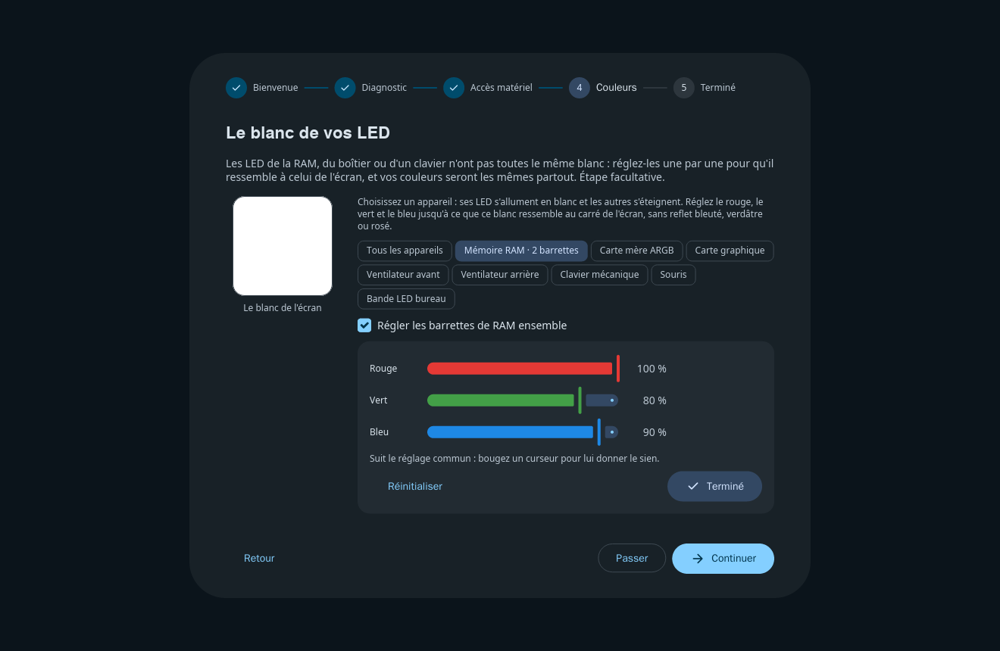
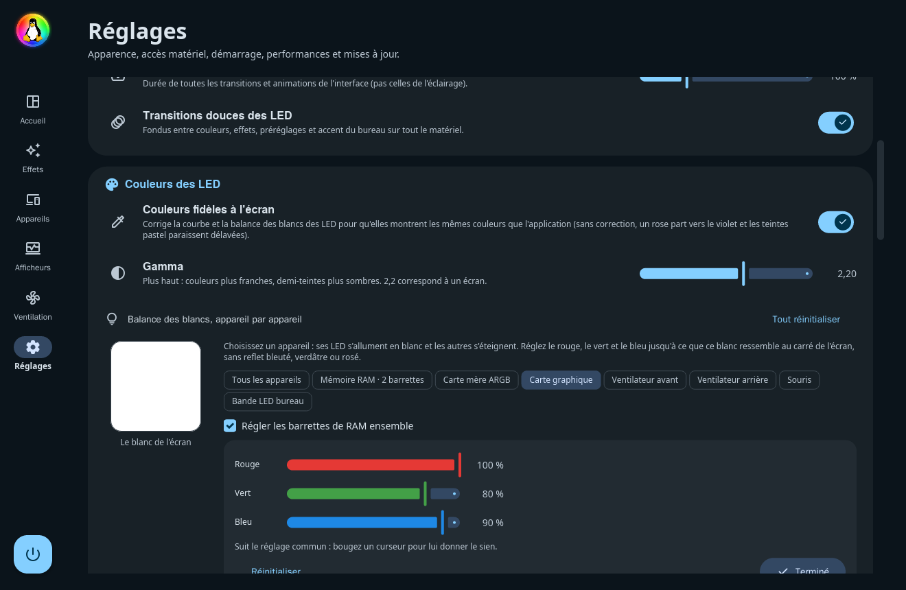
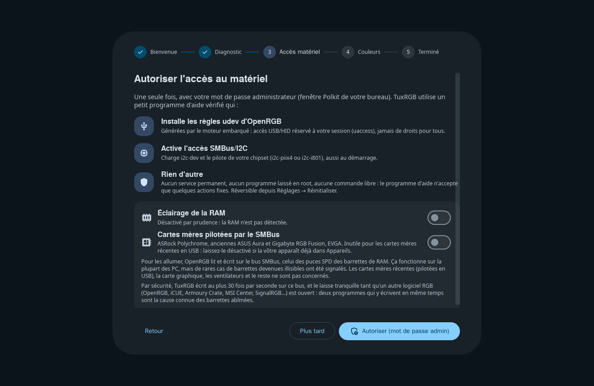

# Fonctionnalités

[← Retour au README](../README.md)

| | |
|---|---|
| Interface | 100 % Rust, [iced 0.14](https://iced.rs) (wgpu, repli tiny-skia), Wayland pur (pas de X11/XWayland) |
| Mouvement | **Rien ne change brusquement** : transitions « fade through » M3 entre pages, sous-pages et étapes de l'assistant (fondu sortant puis entrant avec léger agrandissement, sans recalcul de la mise en page) ; boîtes de dialogue qui s'estompent et grandissent, voile qui s'assombrit ; sélecteur de couleur et bandeaux qui se déplient / se replient en fondu ; contenu des panneaux (effet, appareil, statuts) qui apparaît en fondu ; boutons, segments, puces et cartes qui glissent vers leurs nouvelles couleurs ; champs de saisie et barres de défilement qui s'animent ; défilement à la molette fluide ; nouveaux appareils qui apparaissent en fondu dans la liste et sur le canevas ; **vitesse réglable** de toutes ces animations (Réglages → Apparence, 25 à 300 %) |
| Design | Material 3 Expressive : formes très arrondies et formes « cookie », hiérarchie stricte des surfaces, **curseurs expressifs** (piste qui s'épaissit au survol et à la saisie, poignée qui s'affine puis s'écrase / s'étire selon la vitesse, valeur qui suit le doigt par ressort, extrémités élastiques, crans, bulle de valeur), **boutons « squish »** (compression à ressort au clic, gonflement au survol, morphing pilule → squircle), interrupteurs dont le pouce s'étire en glissant, couleurs dynamiques HCT |
| Langues | Français et anglais, langue du système détectée (`LC_ALL` > `LC_MESSAGES` > `LANG` > `LANGUAGE`), choix manuel dans Réglages → Apparence |
| Bureau | KDE Plasma, GNOME, COSMIC (accent via le portail `org.freedesktop.portal.Settings`, repli `kdeglobals` / `gsettings` / thème COSMIC), libellés adaptés (« Synchroniser avec l'accent GNOME »…), avertissement clair pour X11, un bureau sans accent ou une distribution non testée |
| Matériel | OpenRGB 1.1 (16/10/2026) embarqué, lancé en serveur SDK privé (127.0.0.1:6743) : 100 % des périphériques pris en charge par OpenRGB |
| Effets | 19 effets : Statique, Respiration (multi-teintes), Aurore, Plasma, Vague arc-en-ciel, Cycle de couleurs, Vague dégradée, Ciel étoilé, Comète, Scanner, Pluie, Bulles, Tourbillon, Feu, Orage, **Shader GLSL** (GPU), **Visualiseur audio** (PipeWire, sur chaque appareil), **Synchro écran** (portail ScreenCast, par LED), **Moniteur matériel** (température / charge CPU-GPU, mémoire ; en mode automatique, carte graphique → GPU, RAM → mémoire, appareils sans capteur → température CPU, ou charge CPU si elle est illisible) |
| Couleurs | **Palette Système Harmonieuse** (dominante = accent exact du bureau, variante, nuance analogue / complémentaire / triadique), **fondus** entre couleurs, effets, préréglages et changements d'accent (1,2 s), luminosité globale qui suit le curseur quasi instantanément, **saturation 0–200 % perceptuelle** (Okhsv / OKLab : aucune dérive de teinte, aucun écrêtage, luminosité inchangée) appliquée sur le matériel dès l'image suivante, **couleurs fidèles à l'écran** (gamma réglable, et **balance des blancs appareil par appareil** : un carré blanc de l'écran comme référence, l'appareil réglé allumé en blanc et les autres éteints, les barrettes de RAM réglées ensemble ou une par une ; aussi proposée par l'assistant de premier lancement), luminosité appliquée sans changer la teinte |
| Global ou par composant | L'effet de la page Effets s'applique **à tout le setup**. Chaque composant du canevas (appareil, zone, ventilateur) peut aussi **suivre l'effet global**, jouer **son propre effet** avec ses propres réglages (il couvre alors ce composant comme s'il était tout le setup), garder une **couleur** ou rester **éteint** ; « Tout synchroniser » remet tout sur l'effet global |
| Ventilateurs | **Par ventilateur, par connecteur** : un connecteur ARGB se divise en ventilateurs (comme les segments d'OpenRGB, nombre de LED propre à chacun), chacun est un élément du canevas qui se place, se tourne et se redimensionne seul |
| Canevas | **Rotation libre** de chaque élément (curseur 0–359°, poignée de rotation sur le canevas, angles droits magnétiques), éléments **masquables** (toujours connectés et éclairés), élément sélectionné au premier plan, miroir, taille |
| Afficheurs | Page **Afficheurs** : écrans des watercoolings **NZXT Kraken** Z / 2023 / 2024 et **Corsair** (iCUE ELITE LCD, iCUE LINK LCD, XC7, Nautilus), afficheurs numériques **DeepCool** (AK, AG, LS, LD, LP, LQ, AK Digital Pro, boîtiers CH) : température / charge / puissance / fréquence CPU et GPU, mémoire, heure, texte ou image, activation, fréquence de rafraîchissement, luminosité et orientation des écrans, aperçu en direct ; pilotes libres en USB HID, sans logiciel du fabricant |
| Ventilation | Page **Ventilation** : chaque ventilateur branché sur la carte mère (processeur, boîtier, pompe) avec sa vitesse en direct, laissé à la **carte mère**, à une **vitesse fixe** ou sur une **courbe** (points déplaçables à la souris, modèles Silencieux / Équilibré / Performance) qui suit le processeur, la carte graphique ou un capteur de la carte mère ; bouton « Identifier ». **Sécurité** : 100 % pour tous les ventilateurs pilotés à 90 °C (jusqu'à 85 °C), carte mère qui reprend la main si la température suivie devient illisible, réglages d'origine rendus à l'arrêt. Linux : petit service système `tuxrgb-fans` (installé une fois via Polkit, comme `fancontrol`), actif dès le démarrage, pilotes `it87` / `nct6775` chargés si besoin. Windows : contrôleurs ITE et Nuvoton via PawnIO en mode administrateur (registres de LibreHardwareMonitor), processus de garde qui rend les ventilateurs à la carte mère si TuxRGB s'arrête brutalement. Les ventilateurs de la carte graphique restent à ses propres outils : AMD Adrenalin / application NVIDIA sous Windows, LACT sous Linux |
| Effets matériels | Un clavier, une souris ou une ampoule WiZ peut jouer **son propre effet** (réactions aux touches, scènes) au lieu de ceux de TuxRGB |
| Lumières réseau | **WLED** (DDP, nombre de LED lu), **Philips Hue** (pont associé d'un bouton ; lumière par lumière ou zones de divertissement, rapides), **Philips WiZ**, **Govee** (contrôle LAN), **LIFX** (zones des bandes et Beam détectées), **Nanoleaf** (associé d'un bouton), **Yeelight** (contrôle LAN), **Elgato** Key Light et Light Strip, **TP-Link Kasa** en couleur : une seule **recherche sur le réseau** pour toutes les marques (mDNS, diffusion, multidiffusion), ou l'adresse IP à la main ; des appareils comme les autres. Les lumières lentes (Yeelight : 60 commandes par minute, Hue sans divertissement…) reçoivent leurs couleurs à leur rythme, la dernière toujours appliquée |
| Prudence sur la RAM | L'éclairage de la **RAM** et celui des cartes mères pilotées par le **SMBus** (anciennes ASUS Aura, ASRock Polychrome, Gigabyte RGB Fusion SMBus, EVGA) sont **désactivés par défaut** sur une nouvelle installation, chacun avec son interrupteur (assistant et Réglages → Accès matériel) : il faut écrire sur le bus des puces SPD des barrettes, ce qui a rendu de rares barrettes illisibles. Quand ils sont activés : **jamais en même temps qu'un autre logiciel RGB** (OpenRGB, iCUE, Armoury Crate, MSI Center, SignalRGB, liquidctl, i2c-tools… : RAM laissée de côté, reprise automatique à sa fermeture), **30 écritures par seconde au plus** sur le bus, verrou partagé avec les outils de surveillance sous Windows. Détails dans [SECURITE.md](SECURITE.md) |
| Accès matériel | Assistant de premier lancement + « Réinitialiser les permissions / Accès matériel » (Polkit/pkexec, programme d'aide vérifié), correctif SMBus sur toutes les distributions, appliqué seulement si nécessaire |
| Zone de notification | StatusNotifierItem (ksni), catégorie *ApplicationStatus* (à côté de Steam, pas parmi les contrôles système) : effet, luminosité, extinction, sans fenêtre ouverte ; notifications de bureau avec action directe |
| Écran éteint | Les LED s'éteignent en fondu quand l'écran se met en veille et reviennent dès qu'il se rallume (KDE : état DPMS de KWin ; GNOME : Mutter ; autres bureaux Wayland : inactivité ; Windows : état de l'écran), désactivable dans Réglages → Démarrage |
| Extinction | **Toutes** les LED (carte mère et ventilateurs compris) éteintes à l'arrêt, au redémarrage, à la mise en veille et à la fermeture de session, avec un délai strict de 400 ms (inhibiteur logind / `WM_QUERYENDSESSION`) : l'arrêt du système n'est jamais ralenti ; état exact restauré au démarrage |
| Mises à jour | Réglages → **Mises à jour** : version la plus récente lue sur les releases GitHub, téléchargement vérifié (taille, SHA-256, format), AppImage remplacée sur place puis redémarrage (Linux), installateur silencieux qui relance TuxRGB (Windows) ; vérification automatique au démarrage, au plus toutes les 6 heures (désactivable) ; Flatpak et paquets : page de la version |
| Distribution | AppImage prête à l'emploi (Bazzite, Aurora…), manifest Flatpak, fichiers pour paquets natifs |
| Sobriété | Moteur OpenRGB embarqué qui dort entre deux mises à jour au lieu de vérifier ses contrôleurs mille fois par seconde (Linux : environ 0,3 % d'un cœur avec un effet fixe), aperçu ralenti à quelques images par seconde dès que la fenêtre n'est plus dessinée (réduite, autre bureau), moteur d'effets endormi quand rien n'utilise ses images, aucun tampon alloué par image (LED, captures d'écran, shaders), lueur des aperçus calculée hors du fil de l'interface, mémoire de la fenêtre rendue au système quand elle se ferme (environ 15 Mo de RAM lancé dans la zone de notification) |

## Captures

| Effets | Palette Système Harmonieuse | Moniteur matériel |
|---|---|---|
|  |  |  |

| Appareils et canevas | Réglages | Assistant |
|---|---|---|
|  |  |  |

| Ventilateurs par connecteur | Effet matériel d'un clavier | Lumières réseau |
|---|---|---|
|  |  |  |

| Effet propre d'un ventilateur | Afficheurs (écran AIO, afficheur numérique) | Ventilation (courbe, vitesse fixe) |
|---|---|---|
|  |  |  |

| Balance des blancs (assistant) | Balance des blancs (réglages) | Prudence sur la RAM (assistant) |
|---|---|---|
|  |  |  |

Les mêmes captures en anglais sont dans `docs/screenshots/en/` (utilisées par
la fiche AppStream). Elles sont produites par `tuxrgb --screenshot-tour`, qui
ne modifie jamais `config.json`.
